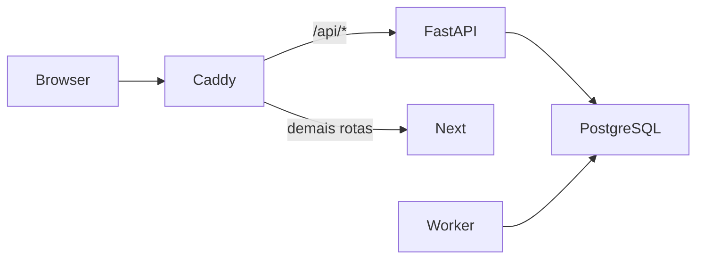

# Permaneço

MVP de acompanhamento acolhedor para estudantes de cursos EAD. O M1 usa somente dados sintéticos.

## Rodar localmente

1. Execute `make setup` para criar `.env` com uma chave aleatória local.
2. Execute `make up`.
3. Execute `make seed` e abra <http://localhost:8080>.

O Compose publica somente em `localhost`. O ambiente local usa HTTP para simplificar a demonstração. `COOKIE_SECURE=false` só deve ser usado nesse ambiente; ambientes externos devem usar TLS e `COOKIE_SECURE=true`.

## Contas de demonstração

As contas são criadas por `make seed`, somente quando `DEMO_MODE=true`. A senha é definida por `DEMO_PASSWORD` no arquivo `.env`; o valor de exemplo é deliberadamente conhecido e não deve ser reutilizado fora da demonstração.

- `ana@example.com` — estudante
- `bruno@example.com` — estudante
- `tutor1@example.com` — tutor
- `admin@example.com` — administração

## Deploy público (Render)

1. Entre no Render com sua conta GitHub e conceda acesso ao repositório privado `KazuyaGIH/permaneco-mvp`.
2. No painel, escolha **New → Blueprint**, selecione este repositório e a branch `m2-nucleo-ia`.
3. Ao sincronizar o Blueprint, preencha `GEMINI_API_KEY` e `DEMO_PASSWORD` com os valores da demonstração.
4. Depois do deploy, abra a URL pública de `permaneco-web`, o serviço destinado aos avaliadores.

O login de estudante é `ana@example.com`; use a senha definida em `DEMO_PASSWORD`. O frontend encaminha `/api/*` ao backend pela URL HTTPS pública do serviço, preservando chamadas same-origin no navegador. O Blueprint não cria worker porque a cadência atual é M3.

No plano gratuito, os serviços web entram em repouso após 15 minutos sem tráfego e podem levar cerca de um minuto para voltar. O Postgres gratuito expira após 30 dias. A franquia é de 750 horas de instância por mês, compartilhadas no workspace.

## Roteiro do M1

Entre como Ana, confira seu perfil, depois acesse como tutor para consultar somente estudantes atribuídos. A conta administrativa lista apenas contas e papéis, sem conteúdo privado.

## Arquitetura

## Limitações

O M1 estabelece autenticação, autorização, persistência, criptografia e execução local. Chat, IA, cadência funcional, painel e fluxos de consentimento completos fazem parte de marcos posteriores. O rate limiting é em memória e não é compartilhado entre réplicas.

## Antes de usar dados reais

Use um provedor de IA em plano apropriado e com termos que proíbam treinamento com os dados; avalie transferência internacional conforme a LGPD; produza RIPD; defina a base legal com o encarregado de dados da instituição — consentimento pode não ser livre se o acompanhamento for obrigatório — e valide o protocolo de crise com profissionais de saúde mental e plantão humano. O M1 não deve receber dados reais.
