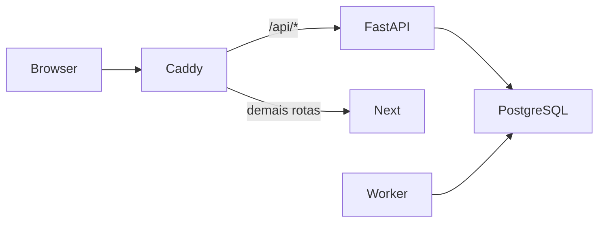

# Permaneço (MVP)

Este é o app da solução do Datathon. A análise que motivou a solução está em [`../datathon/`](../datathon/) e o passo a passo de uso está em [`docs/MANUAL.md`](docs/MANUAL.md).

MVP da Permaneço, uma mentora de IA com memória que acompanha calouros de cursos EAD para reduzir a evasão no início do curso. Usa somente dados sintéticos.

O MVP inclui login com papéis, consentimento, chat com IA em tempo real (Gemini, modelos gratuitos), remoção automática de CPF e e-mail, defesa em camadas contra prompt injection, plano de estudos/carreira/finanças e memórias que o aluno vê e apaga.

## Requisitos

- Docker Desktop (ou Docker Engine com Compose)
- Uma chave gratuita do Gemini: <https://aistudio.google.com/apikey>

## Rodar localmente

### Linux/macOS

Entre na pasta `permaneco/` antes dos comandos abaixo.

1. Execute `make setup` para criar `.env` com uma chave aleatória local.
2. Preencha `GEMINI_API_KEY=` no `.env`.
3. Execute `make up`.
4. Execute `make seed` e abra <http://localhost:8080>.

### Windows (PowerShell)

```powershell
git clone https://github.com/KazuyaGIH/datathon-impacta-banana-date.git
cd datathon-impacta-banana-date\permaneco
$b = New-Object byte[] 32; [Security.Cryptography.RandomNumberGenerator]::Create().GetBytes($b); $k = [Convert]::ToBase64String($b)
(Get-Content .env.example) -replace '^DATA_ENCRYPTION_KEY=$', "DATA_ENCRYPTION_KEY=$k" -replace '^DATA_ENCRYPTION_KEYS=$', "DATA_ENCRYPTION_KEYS={`"demo`":`"$k`"}" | Set-Content .env -Encoding ascii
notepad .env   # preencha GEMINI_API_KEY= e salve
docker compose up --build -d
docker compose exec backend python -m app.seed
```

Depois abra <http://localhost:8080> e entre com `ana@example.com` / `demo-only-password`.

Sem `GEMINI_API_KEY`, o app sobe, mas o chat não responde. A cota gratuita do modelo principal é pequena; quando ela acaba, o app passa sozinho para o modelo de fallback gratuito.

O Compose publica somente em `localhost`. O ambiente local usa HTTP para simplificar a demonstração. `COOKIE_SECURE=false` só deve ser usado nesse ambiente; ambientes externos devem usar TLS e `COOKIE_SECURE=true`.

## Contas de demonstração

As contas são criadas por `make seed`, somente quando `DEMO_MODE=true`. A senha é definida por `DEMO_PASSWORD` no arquivo `.env`; o valor de exemplo é deliberadamente conhecido e não deve ser reutilizado fora da demonstração.

- `ana@example.com` — estudante
- `bruno@example.com` — estudante
- `tutor1@example.com` — tutor
- `admin@example.com` — administração

## Deploy público (Render)

1. Entre no Render com sua conta GitHub e conceda acesso ao repositório `KazuyaGIH/datathon-impacta-banana-date`.
2. No painel, escolha **New → Blueprint**, selecione este repositório e a branch `main`. O `render.yaml` fica em `permaneco/render.yaml`, então informe esse caminho se o Render pedir.
3. Ao sincronizar o Blueprint, preencha `GEMINI_API_KEY` e `DEMO_PASSWORD` com os valores da demonstração.
4. Depois do deploy, abra a URL pública de `permaneco-web`, o serviço destinado aos avaliadores.

O login de estudante é `ana@example.com`; use a senha definida em `DEMO_PASSWORD`. O frontend encaminha `/api/*` ao backend pela URL HTTPS pública do serviço, preservando chamadas same-origin no navegador. O Blueprint não cria worker porque a cadência atual é M3.

No plano gratuito, os serviços web entram em repouso após 15 minutos sem tráfego e podem levar cerca de um minuto para voltar. O Postgres gratuito expira após 30 dias. A franquia é de 750 horas de instância por mês, compartilhadas no workspace.

## Roteiro de avaliação

1. Entre como `bruno@example.com` para ver o consentimento: maioridade, memória e voz opcionais e protocolo de risco.
2. Entre como `ana@example.com` e converse com a mentora na aba **Conversa**. Teste digitar um CPF ou e-mail fictício: ele aparece como `[removido]`.
3. Clique em **Encerrar conversa**. A mentora gera resumo, memórias e plano.
4. Veja **Meu Plano** (Estudos, Carreira, Finanças) e **O que a Permaneço lembra**, onde cada memória pode ser apagada.
5. Entre como tutor para consultar somente estudantes atribuídos. A conta administrativa lista apenas contas e papéis, sem conteúdo privado.

## Arquitetura



## Limitações

O M1 estabelece autenticação, autorização, persistência, criptografia e execução local. Chat, IA, cadência funcional, painel e fluxos de consentimento completos fazem parte de marcos posteriores. O rate limiting é em memória e não é compartilhado entre réplicas.

## Antes de usar dados reais

Use um provedor de IA em plano apropriado e com termos que proíbam treinamento com os dados; avalie transferência internacional conforme a LGPD; produza RIPD; defina a base legal com o encarregado de dados da instituição — consentimento pode não ser livre se o acompanhamento for obrigatório — e valide o protocolo de crise com profissionais de saúde mental e plantão humano. O M1 não deve receber dados reais.
